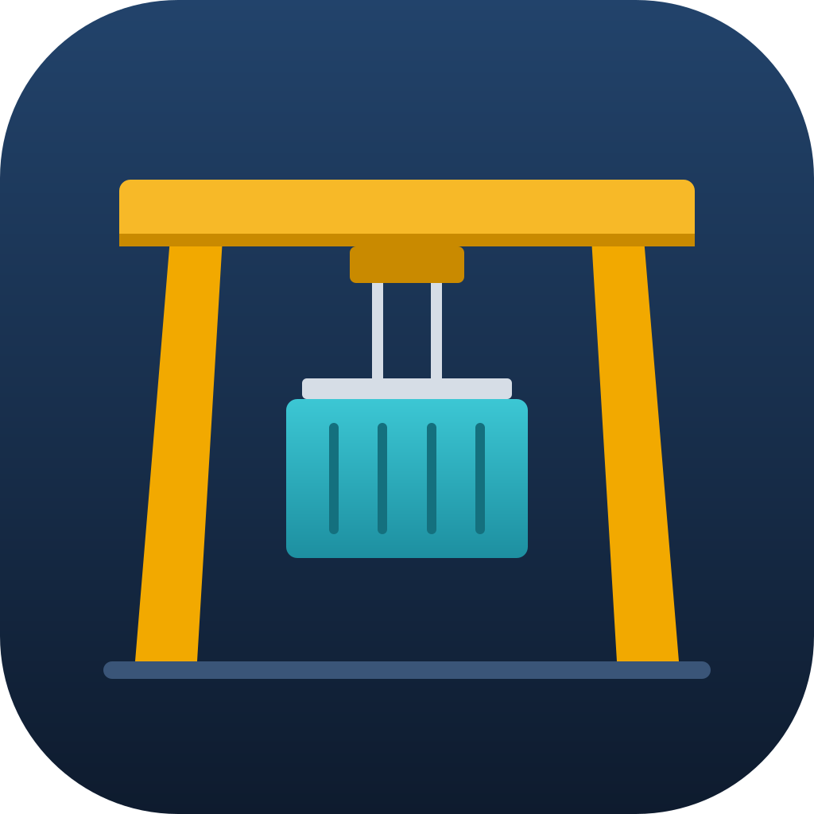

<p align="center"></p>

# Gantry

A native desktop client for Docker engines: manage containers, Compose stacks, images, volumes and networks, with an engine overview and guided cleanup, on your local engine and on remote hosts over SSH. Think Portainer without the server container, or the Docker Desktop dashboard for any engine.

Gantry is a client only. It connects to an engine you already run:

| Platform | Engine                                                |
| :------- | :---------------------------------------------------- |
| Linux    | Docker CE (`/var/run/docker.sock`), rootless Docker   |
| macOS    | Docker Desktop, Colima, OrbStack                      |
| Windows  | Docker Desktop, Docker CE in WSL2                     |
| Any      | Remote hosts over SSH, TCP endpoints, Docker contexts |

> Status: early development. See the [issues](https://github.com/GravionLabs/gantry/issues) for the roadmap.

## Development

Requirements: Node.js 24 with pnpm, Rust (see `rust-toolchain.toml`) and the [Tauri prerequisites](https://tauri.app/start/prerequisites/) of your platform.

```sh
pnpm install
pnpm tauri dev
```

Checks: see [AGENTS.md](AGENTS.md#verification).

## License

Licensed under either of [Apache License, Version 2.0](LICENSE-APACHE) or [MIT license](LICENSE-MIT) at your option.
